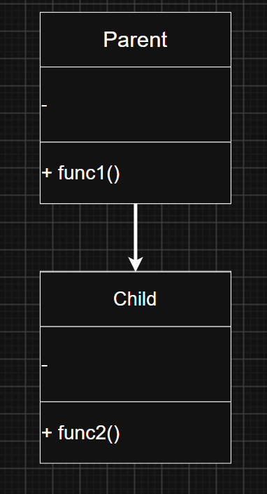
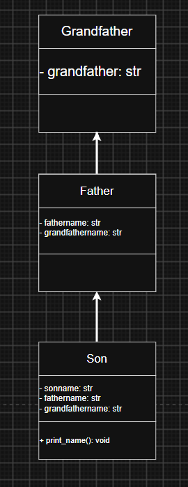
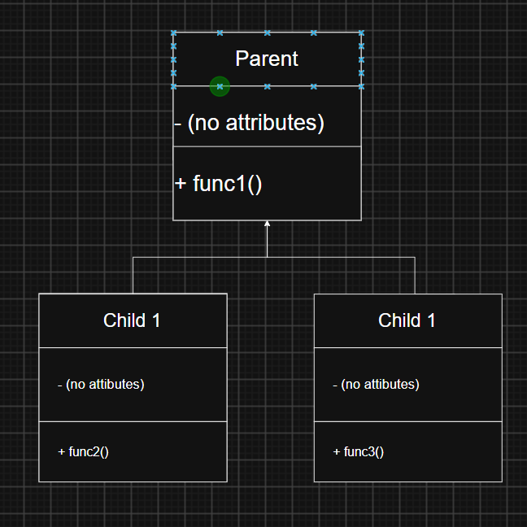
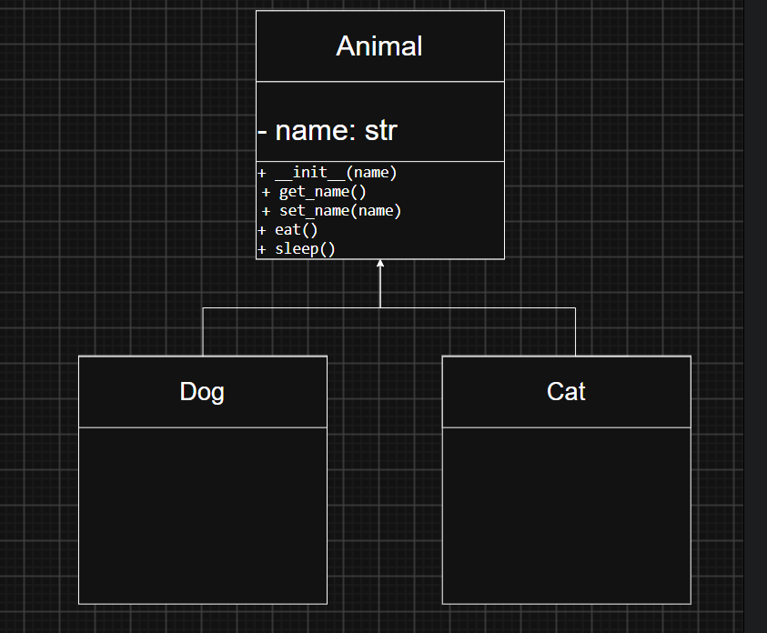
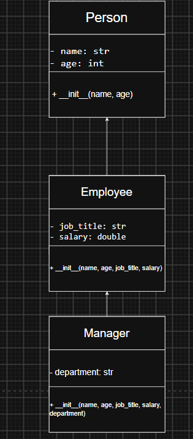

Activity 2 – Types of Inheritance

1. Class diagrams
A. Single inheritance
       

class Parent:
    def func1(self):
        print("This function is in parent class.")

class Child(Parent):
    def func2(self):
        print("This function is in child class.")

obj = Child()
obj.func1()
obj.func2()

B. Multilevel inheritance
       

class Grandfather:
    def __init__(self, grandfathername):
        self.grandfathername = grandfathername

class Father(Grandfather):
    def __init__(self, fathername, grandfathername):
        self.fathername = fathername
        Grandfather.__init__(self, grandfathername)

class Son(Father):
    def __init__(self, sonname, fathername, grandfathername):
        self.sonname = sonname
        Father.__init__(self, fathername, grandfathername)

    def print_name(self):
        print('Grandfather name :', self.grandfathername)
        print('Father name :', self.fathername)
        print('Son name :', self.sonname)

s1 = Son('Prince', 'Rampal', 'Lal mani')
print(s1.grandfathername)
s1.print_name()

C. Hierarchical
    

class Parent:
    def func1(self):
        print("This function is in parent class.")

class Child1(Parent):
    def func2(self):
        print("This function is in child 1.")

class Child2(Parent):
    def func3(self):
        print("This function is in child 2.")

object1 = Child1()
object2 = Child2()
object1.func1()
object1.func2()
object2.func1()
object2.func3()

2.  Example 1: Animal Parent Class with Dog and Cat Child Classes
    

class Animal:
    def __init__(self, name):
        self.__name = name  # Private attribute for encapsulation

    # Getter for name
    def get_name(self):
        return self.__name

    # Setter for name
    def set_name(self, name):
        self.__name = name

    def eat(self):
        print(self.__name, "is eating.")

    def sleep(self):
        print(self.__name, "is sleeping.")

class Dog(Animal):
    pass

class Cat(Animal):
    pass

print("--- Example 1 Output ---")
animal1 = Animal("Generic Animal")
dog1 = Dog("Bruno")
cat1 = Cat("Kitty")

dog1.set_name("Max")

print(dog1.get_name(), "is a dog.")
animal1.eat()
dog1.sleep()
cat1.eat()

Example 2: Person, Employee, and Manager Classes (Multilevel Inheritance)
        

class Person:
    def __init__(self, name, age):
        self.__name = name
        self.__age = age

    def get_name(self):
        return self.__name

    def set_name(self, name):
        self.__name = name

    def get_age(self):
        return self.__age

    def set_age(self, age):
        self.__age = age

class Employee(Person):
    def __init__(self, name, age, job_title, salary):
        super().__init__(name, age)
        self.__job_title = job_title
        self.__salary = salary

    def get_job_title(self):
        return self.__job_title

    def set_job_title(self, job_title):
        self.__job_title = job_title

    def get_salary(self):
        return self.__salary

    def set_salary(self, salary):
        self.__salary = salary

class Manager(Employee):
    def __init__(self, name, age, job_title, salary, department):
        super().__init__(name, age, job_title, salary)
        self.__department = department

    def get_department(self):
        return self.__department

    def set_department(self, department):
        self.__department = department

print("\n--- Example 2 Output ---")
manager = Manager("Alice", 35, "Project Manager", 80000, "IT")

manager.set_salary(85000)

print("Name:", manager.get_name())
print("Age:", manager.get_age())
print("Job Title:", manager.get_job_title())
print("Salary:", manager.get_salary())
print("Department:", manager.get_department())